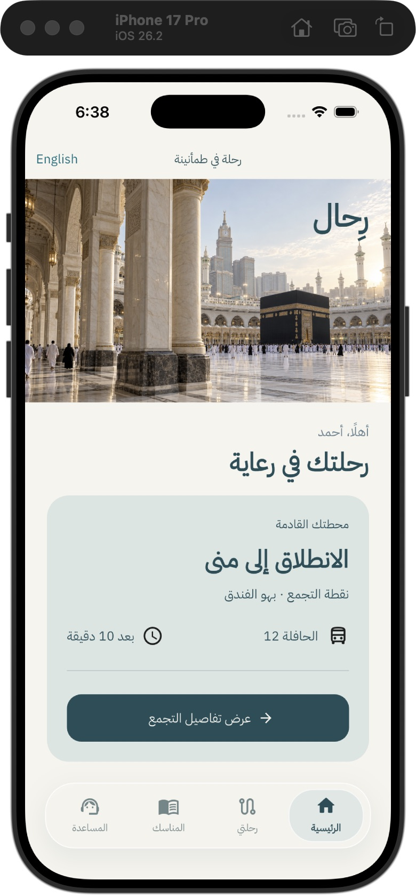

# Rihal · رِحال

**Arabic-first pilgrimage operations, designed around care.**

Two native Flutter apps connect pilgrims and campaign staff to a NestJS/PostgreSQL backend and a React administration console. This public repository is a product case study; implementation source is private and available for an authorized technical review.

> Development milestone 0.1 — an operational slice, not a production launch.

## What works today

- Pilgrim itinerary loaded from PostgreSQL through an authenticated REST API.
- Staff attendance per journey, with duplicate prevention and group-scoped access.
- Administration: create a journey, inspect attendance and record check-in.
- Help requests persisted and visible to the campaign.
- Arabic default, English switching and retained tab navigation.
- Shared Flutter design system and refined floating navigation.

## Engineering evidence

Locally verified on 31 October 2026:

- Both Flutter apps: static analysis and iOS simulator builds passed.
- Two Flutter widget scenarios passed: language/navigation and help submission.
- Three API integration scenarios passed: unauthenticated access, operational permissions/idempotency/version conflicts, and ticket validation/isolation.
- Browser check-in changed absent → present after persistence.
- Source-file size and domain dependency checks passed.

Offline journey caching has been implemented but full offline synchronization and map verification remain in progress. No performance scores or coverage percentages are claimed before measurement.

## Design and architecture

Petrol, warm ivory, mist and sand establish a calm visual language. The journey pass brings the next movement to the foreground. A floating dock uses a shared moving indicator, restrained haptics and reduced-motion support.

Flutter → repository interfaces → REST API → NestJS → PostgreSQL.

Riverpod, go_router, Dio, Drift, Prisma, TanStack Query and i18next support the implementation. Domain models are separated from mobile rendering and transport.

## Next milestones

Production authentication, document review, accommodation/seat assignment, committee-specific workflows, messaging, notifications, approved ritual content, licensed offline maps, broader integration tests and performance profiling.

## Contact / source review

[Contact Hussein on GitHub](https://github.com/Husseinabozina). Source access can be arranged for a technical review.

[العربية](README.ar.md)
